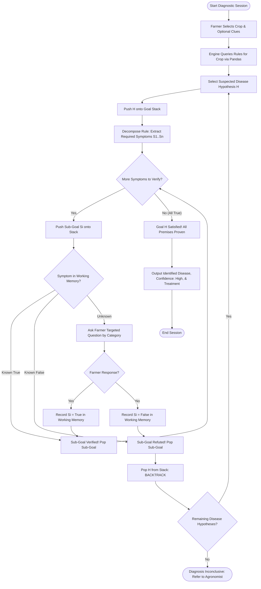
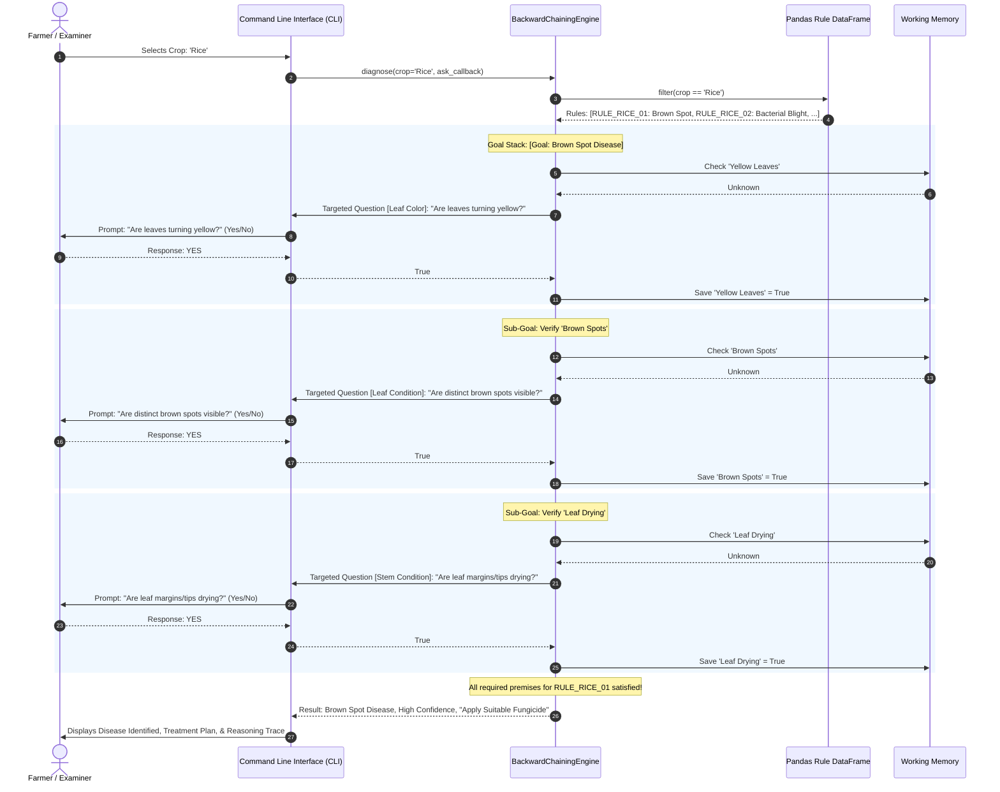
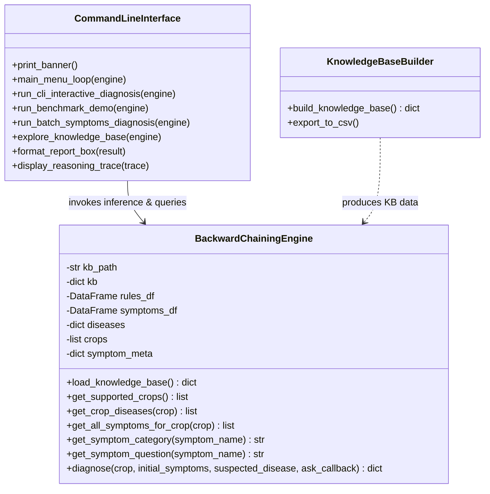
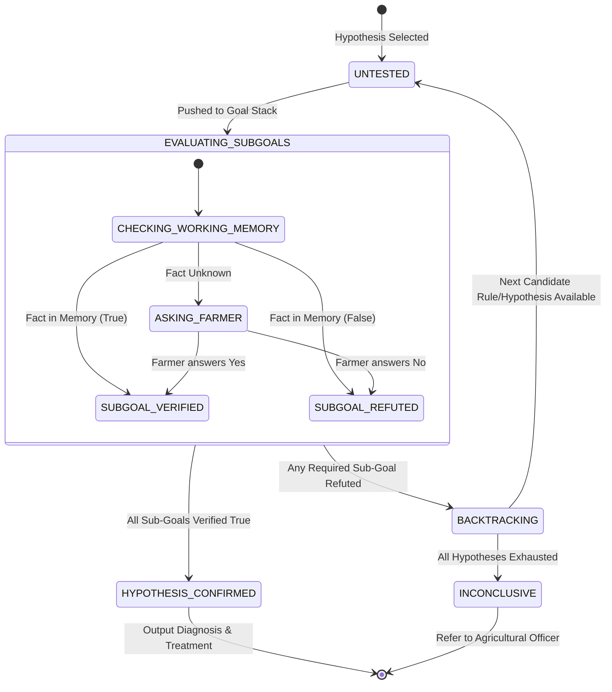

# System Diagrams & Flowcharts

This document provides visual diagrams modeling the **Backward Chaining Inference Engine**, interactive dialogue flow, class relationships, and hypothesis state lifecycles for **Project 35: Crop Disease Expert System**.

---

## 1. Backward Chaining Inference Flowchart

---

## 2. Interactive Sequence Diagram (Rice Sample Case)

---

## 3. Class Diagram

---

## 4. State Transition Diagram: Hypothesis Lifecycle

