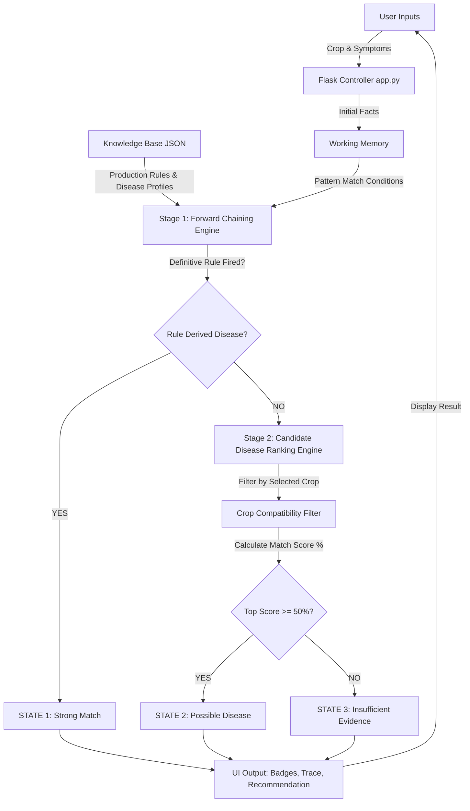
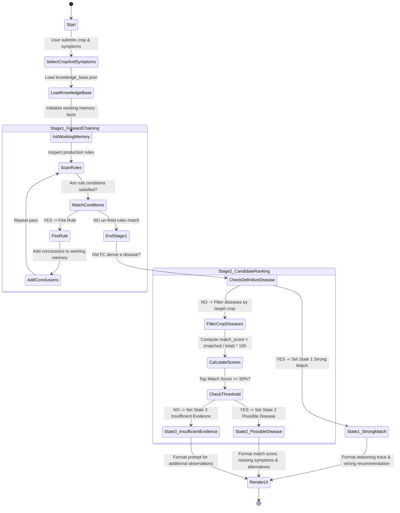

# System Diagrams

This document contains the three core system diagrams for the Crop Disease Expert System: System Architecture, Activity Diagram, and Data Flow Diagram (DFD Level 1), reflecting the Two-Stage Reasoning process and Three Result States.

---

## 1. System Architecture Diagram



---

## 2. Activity Diagram



---

## 3. Data Flow Diagram (DFD Level 1)

```
[ User ] 
   │
   │ 1. Form Submission (Crop, Symptoms, Environmental Conditions)
   ▼
( Process 1.0: Fact Collector )
   │
   │ 2. Initial Facts Dictionary
   ▼
( Process 2.0: Two-Stage Inference Engine ) ◄──── [ Knowledge Base Store (JSON) ]
   │                                              (DigiGreen Rules & Disease Profiles)
   ├─► Stage 1: Forward Chaining Loop
   └─► Stage 2: Candidate Ranking Fallback (if no FC rule derived)
   │
   │ 3. State Output (Strong Match / Possible Disease / Insufficient Evidence)
   ▼
( Process 3.0: Explanation Generator )
   │
   │ 4. Matched/Missing Symptoms, Reasoning Trace, Alternatives, Recommendation
   ▼
[ User ]
```
