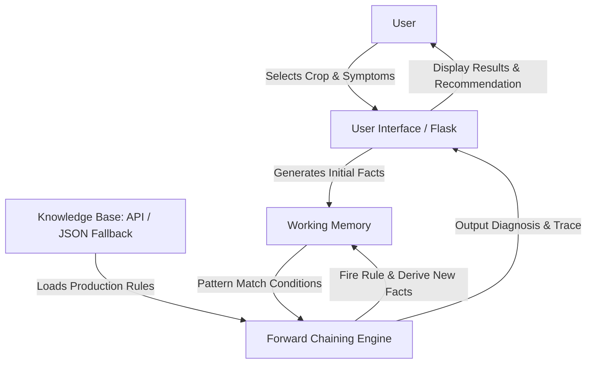
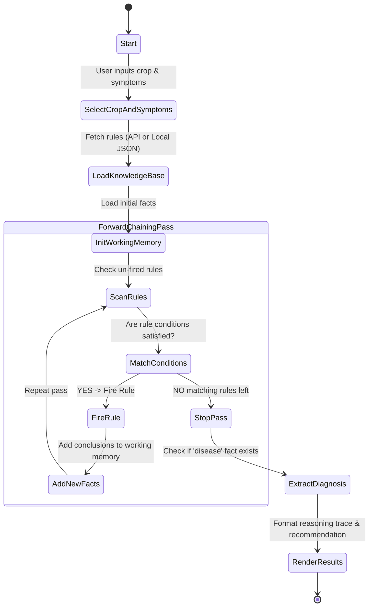

# System Diagrams

This document contains the three core system diagrams for the Crop Disease Expert System: System Architecture, Activity Diagram, and Data Flow Diagram (DFD).

---

## 1. System Architecture Diagram



---

## 2. Activity Diagram



---

## 3. Simple Data Flow Diagram (DFD Level 1)

```
[ User ] 
   │
   │ 1. Form Submission (Crop, Symptoms, Environment)
   ▼
( Process 1.0: Fact Collector )
   │
   │ 2. Initial Facts Dictionary
   ▼
( Process 2.0: Forward Chaining Engine ) ◄──── [ Knowledge Base Store (JSON/API) ]
   │                                              (Rules & Disease Metadata)
   │ 3. Working Memory Updates & Fired Rules
   ▼
( Process 3.0: Explanation Generator )
   │
   │ 4. Diagnosis, Reasoning Trace, Recommendation
   ▼
[ User ]
```
